# Introduction

Large language models (LLMs) answer better when they can retrieve relevant context at inference time [@lewis2020rag]. In practice this requires a vector store: a system that embeds documents, indexes the vectors for approximate nearest-neighbour search, and returns the closest matches to a query. Most production vector databases are network services, either hosted [@pinecone] or self-managed [@wang2021milvus]. That model suits large shared deployments, but it fits three growing groups of users poorly. The first is developers who want retrieval inside a single Python process with no server to run. The second is organisations whose data may not leave the machine for privacy or regulatory reasons. The third is AI assistants that need a private, durable memory of the person they work with.

The third group is new. Assistants can now call local tools through the Model Context Protocol (MCP) [@mcp2024], an open standard for connecting language-model clients to tools and data. A local memory store reachable over MCP lets an assistant recall on Friday a preference that a person stated on Monday, without that memory ever leaving the person's computer. Prior work on agent memory, such as the memory stream of Generative Agents [@park2023generative] and the memory hierarchy of MemGPT [@packer2023memgpt], shows that relevance, importance and recency all matter when deciding what an agent should recall. These systems describe memory architectures. They do not provide an embeddable, encrypted store with a standard tool interface.

VecForge is an embedded, local-first [@kleppmann2019localfirst] vector database for Python. Its first public releases (1.0 and 1.1) combined FAISS [@johnson2019faiss; @douze2024faiss] dense search, BM25 keyword search [@robertson2009bm25], SQLCipher encryption [@sqlcipher] and a reranker motivated by Grover's search algorithm [@grover1996]. An audit of the 1.x code for this work found three structural problems. Namespace isolation was a post-filter over a fixed window of $4k$ candidates, so a small namespace in a large vault lost most of its true neighbours. The BM25 index was rebuilt from the whole corpus on every insert, which made ingestion quadratic. And the reranker applied Grover's diffusion operator without its oracle, which, as we show, either keeps or reverses the input ranking depending only on the parity of the iteration count.

This paper describes VecForge 2.0, which redesigns these parts and adds a persistent memory layer, and it evaluates every feature of the system. It makes the following contributions.

1. **A storage and retrieval design for embedded hybrid search.** One encrypted file holds all state. Writes are atomic across the file and the in-memory indexes. Namespace and deletion constraints are enforced inside FAISS through ID selectors and inside an incremental inverted-index BM25, with exact fallbacks where approximate search would lose recall. Index snapshots inside the vault, validated by a generation counter, remove the rebuild on reopening.
2. **Persistent agent memory over MCP.** Typed memories, near-duplicate reinforcement, sessions, and a recall score that blends relevance, importance and recency are exposed to MCP clients through twelve tools.
3. **An analysis and correction of Grover-inspired reranking.** We prove that diffusion-only reranking is an involution, confirm it on 255 list sizes, and give an O(N) closed form of oracle-plus-diffusion amplitude amplification [@brassard2002amplitude] that preserves order within the marked and unmarked sets.
4. **A feature-by-feature evaluation.** Eighteen experiments measure retrieval quality on a public benchmark, recall under constraints, indexing and reopening cost, encryption and security overhead, deletion, filtering, ingestion, memory deduplication, the MCP and REST interfaces, and concurrency. We report the results that do not favour the design as well as those that do.

Section 2 reviews related work. Section 3 states the design goals and gives an overview. Sections 4 to 8 describe storage, retrieval, reranking, security and agent memory. Section 9 covers the interfaces and ingestion. Section 10 sets out the evaluation method and Section 11 the results. Section 12 discusses limitations and threats to validity, and Section 13 concludes.

# Background and Related Work

**Vector search.** FAISS provides exact and approximate nearest-neighbour indexes on CPU and GPU [@johnson2019faiss; @douze2024faiss], including product quantisation [@jegou2011pq] and Hierarchical Navigable Small World (HNSW) graphs [@malkov2020hnsw]. Purpose-built vector databases such as Milvus [@wang2021milvus] add storage, filtering and distribution on top of such indexes. Embedded stores trade scale for simplicity: the database is a library and a file. VecForge belongs to this second group and uses FAISS for indexing and SQLite [@sqlite] for durable storage.

**Hybrid retrieval.** Lexical retrieval with BM25 [@robertson2009bm25] remains a strong baseline, and combining it with dense retrieval often beats either alone [@thakur2021beir]. The two common fusion functions are reciprocal rank fusion (RRF) [@cormack2009rrf] and a convex combination of normalised scores. Bruch et al. [@bruch2023fusion] analyse both and find that a tuned convex combination is competitive with or better than RRF and is more sample-efficient to tune. VecForge uses a convex combination of min-max normalised scores. Cross-encoder rerankers [@nogueira2019passage] over sentence embeddings [@reimers2019sbert; @wang2020minilm] can refine the final list.

**Encryption and access control in embedded stores.** SQLCipher [@sqlcipher] encrypts every SQLite page with AES-256 [@nist2001aes], so a stolen file reveals nothing without the key. Role-based access control [@sandhu1996rbac] assigns permissions to roles rather than to individual users. Most embedded vector stores leave both to the application. VecForge provides them in the library, because a local-first store is often the only place where such controls can be enforced.

**Agent memory.** Generative Agents [@park2023generative] retrieve memories by a weighted sum of recency, importance and relevance. MemGPT [@packer2023memgpt] manages a hierarchy of in-context and external memory. Both inform the recall score in VecForge. Our contribution here is an engineering one: an encrypted, embeddable store with per-agent isolation, deduplication and a standard tool interface through MCP [@mcp2024].

**Quantum-inspired retrieval.** Grover's algorithm finds a marked item among $N$ in $O(\sqrt{N})$ queries by alternating an oracle, which flips the phase of marked states, with a diffusion operator, which reflects about the mean [@grover1996]. Amplitude amplification generalises this to arbitrary initial states [@brassard2002amplitude]. Classical "quantum-inspired" algorithms borrow such structure to obtain useful classical procedures [@tang2019quantuminspired]. In ranking, the appeal is that amplification concentrates probability mass on a chosen subset. As Section 6 shows, the oracle is not optional: without it, diffusion carries no information about which items to favour.

Table 1 places VecForge among these classes of systems.

Table: **Table 1.** Capabilities by class of system. "Library" means the capability is provided by the system itself rather than left to the application.

| Capability | ANN library | Client-server vector database | Embedded vector store | Agent memory framework | VecForge 2.0 |
|:-----------------------------------|:-----------:|:-------------:|:-------------:|:-------------:|:-----------:|
| Runs inside the application process | yes | no | yes | varies | yes |
| Durable storage of text and metadata | no | yes | yes | yes | yes |
| Dense and keyword retrieval with fusion | no | often | varies | rarely | yes |
| Encryption at rest in the library | no | varies | rarely | rarely | yes |
| Roles, API keys and audit log | no | yes | rarely | rarely | yes |
| Importance and recency in recall | no | no | no | yes | yes |
| Standard tool interface (MCP) | no | varies | varies | varies | yes |

# Design Goals and Overview

## Design goals

VecForge 2.0 was designed against six goals, listed in Table 2 with the mechanisms that address them and the experiments that test them.

Table: **Table 2.** Design goals, mechanisms and the experiments that evaluate them.

| Goal | Mechanism | Experiments |
|:-----------------------------|:----------------------------------------|:---------------|
| G1. One local file, private by default | SQLite vault, SQLCipher AES-256, localhost-only server | E9 |
| G2. Good retrieval quality without tuning | Dense and BM25 fusion with a fixed default weight | E8, E17 |
| G3. Constraints that never cost recall | ID selectors inside FAISS and BM25, adaptive widening for filters, tombstones | E4, E10, E11 |
| G4. Cheap writes and fast restarts | Incremental BM25, snapshots checked by a generation counter | E3, E5 |
| G5. Durable, private memory for assistants | Memory layer, deduplication, sessions, MCP server | E7, E13, E14 |
| G6. Safe multi-user access | Roles, hashed API keys, audit log, REST server, thread-safe vault | E15, E16, E18 |

## Architecture

Figure 1 shows the architecture. A *vault* is one SQLite file. Four clients reach it: the Python API, the MCP server, a REST server and a command-line tool. All of them go through the vault core, which enforces roles, writes the audit log, scopes requests to namespaces and keeps the file and the indexes consistent. In memory, the vault holds a FAISS index over all vectors and a BM25 inverted index over all text. The memory layer is a client of the vault core with its own data model.

{width=100%}

Figure 2 follows one query through the read path. The query is embedded, using a cache of recent query vectors. The vault computes the set of positions the caller may see, which is the namespace minus deleted documents. Dense and sparse retrieval each return their top $m$ candidates from that set, the scores are fused, and the rows are read from SQLite, where metadata filters apply. If fewer than $k$ results survive the filter, the window $m$ grows by a factor of four and the search repeats. Optional reranking and recency weighting finish the query, and each result carries the signals that produced it.

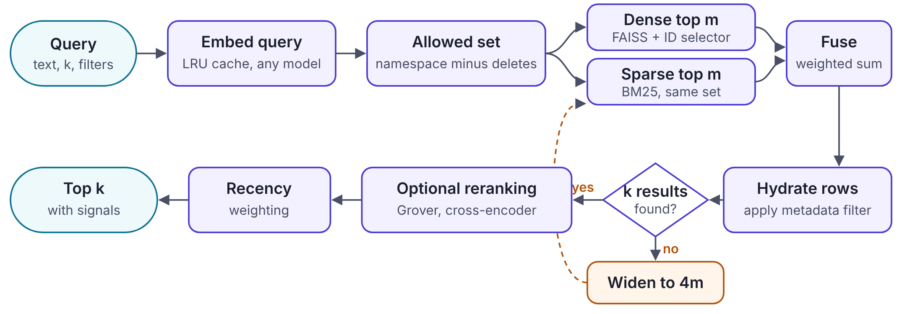{width=100%}

# Storage Layer

## Schema

Figure 3 shows the main tables of schema version 2. The `documents` table stores each document's identifier, namespace, text, embedding as a float32 blob, metadata as JSON, a content hash and timestamps. `namespaces` lists the namespaces, `sessions` holds agent sessions with their summaries, and `kv` is a small key-value store for settings and API-key digests. `index_state` records the generation at which the index snapshot was taken, and `index_chunks` holds the snapshot itself in chunks of at most 64 MB, keyed by kind and sequence number.

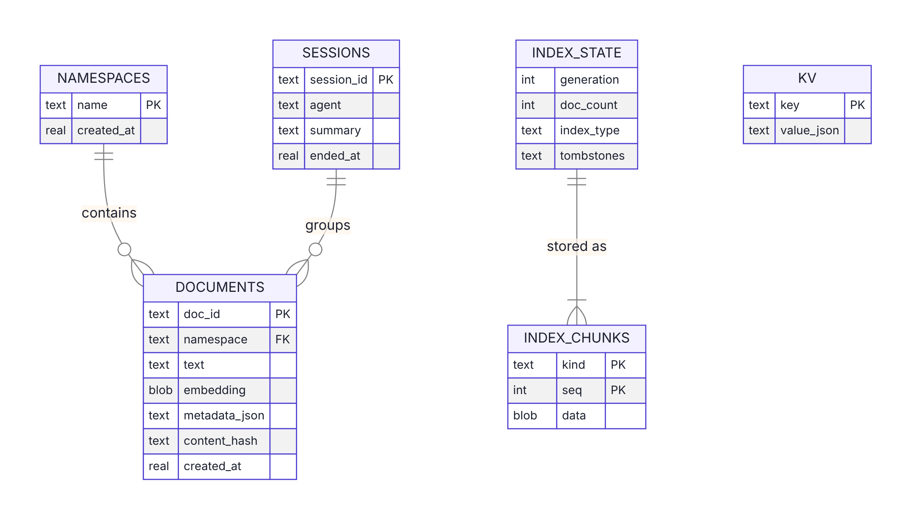{width=78%}

## Atomic writes

A write must leave the file and the in-memory indexes in agreement even if something fails half way. Figure 4 shows how `add_batch` achieves this. The vault checks the caller's role, embeds the texts and checks the vector dimension before touching the database. It then inserts all rows and bumps the generation counter in one SQLite transaction. Only after the commit does it add the vectors to FAISS and the postings to BM25. If the index update fails, the vault deletes the rows it just inserted and rebuilds the indexes from the stored vectors, so the caller sees an error and an unchanged vault. `upsert` replaces a document in one transaction, and `update_metadata` changes metadata without touching vectors.

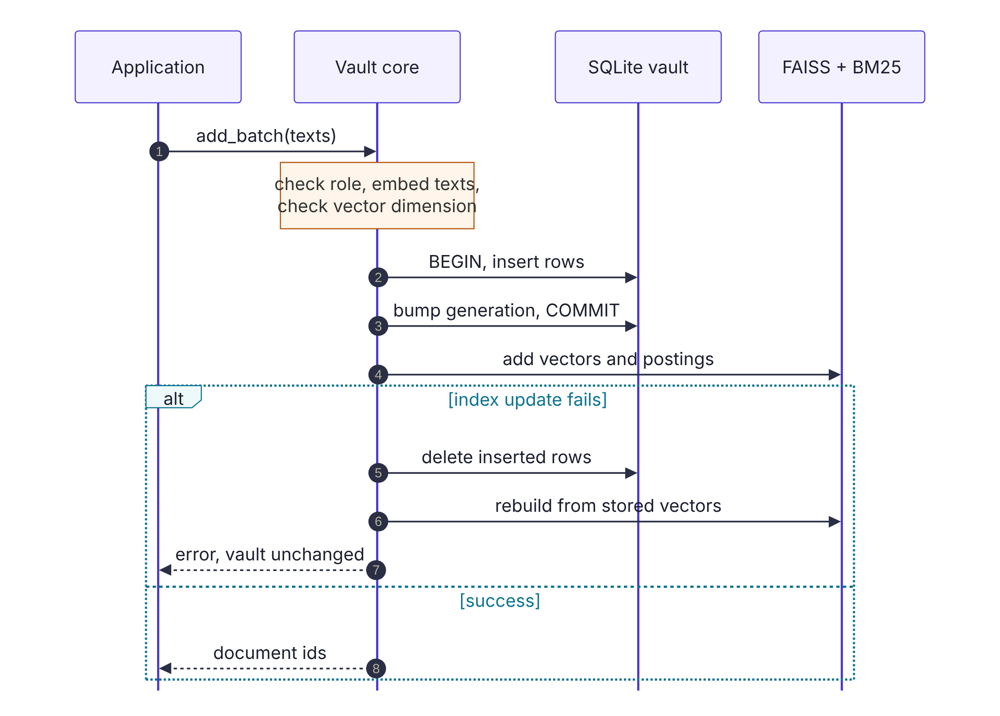{width=74%}

## Generation counter and snapshots

Every write that changes text or vectors increments a monotonic *generation* counter in the same transaction. Metadata-only updates do not, because they do not affect the indexes. On `save()`, on `close()` and every 25 writes in the MCP server, the vault serialises the FAISS index, the BM25 arrays and the map from index positions to document identifiers, splits the bytes into chunks, and stores them together with the current generation. The BM25 index serialises to NumPy arrays without Python pickling, so loading a snapshot cannot execute code.

Figure 5 shows the open path. If the stored snapshot generation equals the current generation, the indexes are loaded directly from the chunks. Otherwise, for example after a crash between a write and a save, the vault rebuilds the indexes from the stored vectors. A rebuild never needs to re-embed text. Because snapshots live inside the vault, they are encrypted whenever the vault is.

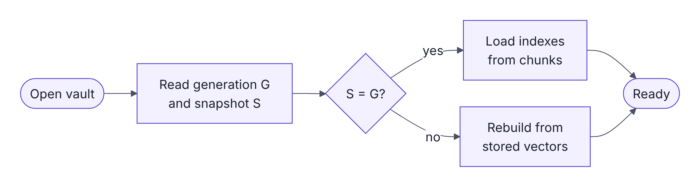{width=70%}

## Encryption

When a key is given, the vault is opened through SQLCipher, which encrypts each database page with AES-256 [@nist2001aes] and authenticates it with an HMAC. Everything in the file is covered: text, vectors, metadata, snapshots, sessions and API-key digests. Without the key the file cannot be opened at all, and with a wrong key VecForge reports an authentication error instead of returning corrupt data. Online backups use the SQLite backup API, so a backup of an encrypted vault is itself encrypted.

# Retrieval

## Embedding models

The embedder is pluggable. VecForge accepts any Sentence-Transformers model [@reimers2019sbert], any Python callable that maps a list of texts to vectors, and a built-in feature-hashing embedder that needs no model download. Query vectors are cached in a least-recently-used cache, so a repeated query skips the model. Section 11 uses all-MiniLM-L6-v2 [@wang2020minilm] through ONNX Runtime [@onnxruntime] for retrieval quality, and the hash embedder for systems experiments where only cost matters.

## Dense retrieval with in-index constraints

Each vector's position in the FAISS index maps to a document identifier. A delete is a *tombstone*: the position joins an exclusion set instead of being removed from the index, which makes a delete O(1). When tombstones exceed 20% of the index and number at least 1,000, the vault compacts by rebuilding from the stored vectors.

Queries restrict the search space inside FAISS. A namespace query builds an `IDSelectorBatch` over the namespace's live positions, combined with an `IDSelectorNot` over the tombstones, and passes it through the FAISS search parameters, so the index scores only allowed vectors. For a flat (exact) index this gives exact results within the namespace. For an HNSW index, graph search under a very restrictive selector can miss allowed neighbours, because routing passes through excluded nodes. VecForge therefore searches exactly over the reconstructed vectors of the allowed subset when it has at most 20,000 members, and otherwise uses filtered graph search with a widened `efSearch`. The index type is `flat`, `hnsw` (M = 32, efConstruction = 200, efSearch = 64) or `auto`, which switches to HNSW above 50,000 vectors.

## Incremental BM25

The keyword index is an inverted index from each term to a growable postings array of (position, term frequency) pairs, with per-document lengths. Adding a document appends to the postings of its terms in $O(|d|)$ time. Scoring uses Okapi BM25 [@robertson2009bm25] with $k_1 = 1.5$, $b = 0.75$ and the non-negative IDF

$$\mathrm{idf}(t) = \ln\!\left(1 + \frac{N - n_t + 0.5}{n_t + 0.5}\right),$$

where $N$ is the number of live documents and $n_t$ the number that contain $t$. A query touches only the postings of its own terms. Deletions are tombstones in the same position space as FAISS, and the namespace selector restricts BM25 scoring to the same allowed set, so the two retrievers always see the same documents.

## Fusion

Let $D$ and $S$ be the dense and sparse candidate sets with raw scores $s_d$ and $s_s$. Each score list is min-max normalised over its candidates, and the fused score is

$$f(x) = \alpha\,\hat{s}_d(x) + (1-\alpha)\,\hat{s}_s(x), \qquad \alpha \in [0,1],$$

with a missing score treated as zero and $\alpha = 0.5$ by default. Each result records which retrievers found it and both raw scores, so an application can explain a ranking. Ties break on the fused score, then on the number of retrievers that found the document, then on the raw dense score, which makes results deterministic.

## Metadata filters

Filters support equality, ranges (`gt`, `gte`, `lt`, `lte`), membership (`in`, `nin`), containment and existence tests on JSON metadata. They are evaluated on hydrated rows, after fusion. A filter may reject most candidates, so a fixed candidate window can return fewer than $k$ results even when enough matching documents exist. VecForge starts with a window of $m = \max(4k, 20)$ and multiplies it by four until $k$ results pass or the whole allowed set has been examined (Figure 2). The cost of this choice is measured in Section 11.4.

# Grover-Inspired Reranking

## Setting

Given $N$ candidates with non-negative relevance scores $r_1 \ge r_2 \ge \dots \ge r_N$, the reranker encodes them as a unit amplitude vector $a = r / \lVert r \rVert_2$, so that $a_i^2$ is a probability. Grover's algorithm acts on such a state with two reflections. The *oracle* $O_M$ flips the sign of the amplitudes in a marked set $M$:

$$(O_M a)_i = \begin{cases} -a_i & i \in M \\ a_i & i \notin M. \end{cases}$$

The *diffusion* operator is the reflection about the uniform state $s = \tfrac{1}{\sqrt{N}}\mathbf{1}$:

$$D = 2ss^{\top} - I, \qquad (Da)_i = 2\bar{a} - a_i, \quad \bar{a} = \tfrac{1}{N}\textstyle\sum_j a_j .$$

One Grover iteration is $G = D\,O_M$. With $\sin\theta = \sqrt{|M|/N}$, $G$ rotates the state by $2\theta$ towards $M$ in the plane spanned by the uniform vectors over $M$ and over its complement [@grover1996; @brassard2002amplitude]. Figure 6 shows this geometry.

{width=52%}

## Diffusion alone is an involution

The 1.x reranker applied $D$ alone, $k$ times, with $k = \lfloor \pi / (4 \arcsin(1/\sqrt{N})) \rfloor$, and ranked candidates by the result.

**Proposition 1.** *$D^2 = I$. Hence $D^k a = a$ for even $k$ and $D^k a = Da$ for odd $k$. Also, $Da$ is a strictly decreasing function of $a$ in each coordinate, so ranking by $Da$ exactly reverses the ranking by $a$.*

*Proof.* $D^2 = 4ss^{\top}ss^{\top} - 4ss^{\top} + I = I$ because $s^{\top}s = 1$. For odd $k$, $(Da)_i = 2\bar{a} - a_i$, and $a_i > a_j$ implies $(Da)_i < (Da)_j$. $\square$

The 1.x reranker therefore carries no information beyond the parity of $k$: it either leaves the ranking unchanged or reverses it, and which one happens depends only on $N$. Diffusion alone cannot amplify relevant items, because nothing tells it which items are relevant. That information is the oracle.

## Oracle and diffusion in closed form

VecForge 2.0 applies $G = D\,O_M$. Running $G$ step by step costs $O(kN)$ with $k = O(\sqrt{N/|M|})$, but $G^k$ has a closed form that costs $O(N)$ for any $k$. Write $m = |M|$, let $u_M$ and $u_U$ be the unit uniform vectors over $M$ and its complement $U$, and decompose

$$a = \alpha_0\,u_M + \beta_0\,u_U + \rho_M + \rho_U,$$

where $\alpha_0 = \tfrac{1}{\sqrt{m}}\sum_{i\in M} a_i$, $\beta_0 = \tfrac{1}{\sqrt{N-m}}\sum_{i \in U} a_i$, and $\rho_M$, $\rho_U$ are the zero-mean residuals within each set. The residuals are orthogonal to $u_M$, $u_U$ and $s$.

**Proposition 2.** *Let $\phi_0 = \operatorname{atan2}(\alpha_0, \beta_0)$, $R = \sqrt{\alpha_0^2 + \beta_0^2}$ and $\phi_k = \phi_0 + 2k\theta$. Then*

$$G^k a = R\sin\phi_k\,u_M + R\cos\phi_k\,u_U + \rho_M + (-1)^k \rho_U .$$

*Proof.* On the plane spanned by $u_M$ and $u_U$, $O_M$ reflects across $u_U$ and $D$ reflects across $s = \sin\theta\,u_M + \cos\theta\,u_U$, so their product is a rotation by $2\theta$. A residual $\rho$ is orthogonal to $s$, so $D\rho = -\rho$. $O_M$ negates $\rho_M$ and fixes $\rho_U$. Hence $G\rho_M = D(-\rho_M) = \rho_M$ and $G\rho_U = D\rho_U = -\rho_U$. $\square$

The best iteration count rotates the state as close as possible to $u_M$: $k^\star = \operatorname{round}\big((\pi/2 - \phi_0)/(2\theta)\big)$. In coordinates, every marked amplitude becomes $a_i + (R\sin\phi_k - \alpha_0)/\sqrt{m}$, so all marked amplitudes shift by the same constant and the marked set keeps its order. Unmarked amplitudes become $R\cos\phi_k/\sqrt{N-m} \pm (a_i - \bar{a}_U)$, whose order flips when $k$ is odd. Rather than expose that artefact, VecForge keeps the amplified probability mass of the unmarked set and redistributes it in proportion to the original probabilities, so the unmarked set also keeps its order. The final scores are scaled to $[0, 1]$.

## Choosing the oracle

The marked set decides what the reranker does. With no external signal, VecForge marks the top $\max(k, \lceil K^{1/2} \rceil)$ candidates of a window of $K \le 1000$ (the default top-$\sqrt{K}$ oracle). This keeps the full order and widens the score gap between the head and the tail. Inside hybrid search VecForge uses a *consensus oracle*, which marks the candidates that both the dense and the sparse retriever returned. Amplification then lifts documents on which the two retrievers agree above documents found by only one, while keeping each group's internal order. An optional cross-encoder then runs only on the survivors. The window is chosen with an $O(N)$ partial sort, so the whole reranker costs $O(N + K)$.

# Security and Governance

## Roles and API keys

VecForge uses role-based access control [@sandhu1996rbac] with three roles. Figure 7 gives the permission matrix. `admin` may do everything, including creating namespaces, managing keys and taking backups. `read-write` may add, update and delete documents. `read-only` may search and read. API keys are stored only as SHA-256 digests, and the REST server compares them in constant time. A key that has not been registered has no access at all; in 1.x it received read-only access. Opening a vault in the local process without a key gives local admin rights, which keeps single-user use simple while still protecting data at rest through encryption.

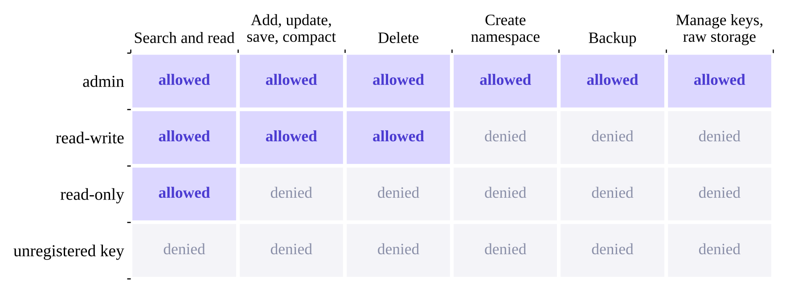{width=82%}

## Audit log and isolation

An optional audit log appends one JSON line per operation, with the time, the operation, the role, the namespace and the number of documents affected. The log records no document text. Namespaces isolate tenants and agents: a caller scoped to one namespace cannot search, read or delete another, because the allowed set of Section 5.2 is computed before retrieval. The REST server binds to localhost by default, limits request sizes, and returns errors without stack traces.

# Persistent Memory for AI Agents

## Memory model

The memory layer stores *memories*: short texts with a kind (fact, preference, decision, task, event or note), an importance in $[0,1]$, tags, an optional session, an access count and timestamps. Each agent writes into its own namespace, so agents that share a vault cannot read or delete each other's memories. Figure 8 shows the life cycle of a memory.

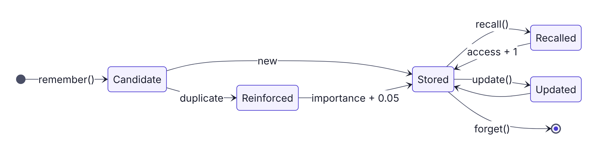{width=86%}

## Writing and deduplication

`remember()` first checks for an exact duplicate by content hash, then for a near duplicate by cosine similarity, with a threshold of 0.92, among memories of the same kind. A duplicate is *reinforced* instead of stored again: its importance rises by 0.05 and never falls below the importance given to the new copy, its tags are merged, and its access count grows. This keeps the store compact when an assistant restates the same fact in several conversations. Section 11.6 shows that this rule has a real failure mode.

## Recall

`recall()` retrieves candidates with the hybrid retriever and scores each memory as

$$\mathrm{score}(m) = (1 - w_r - w_i)\,\mathrm{rel}(m) + w_i\,\mathrm{imp}(m) + w_r\,2^{-\Delta t / h},$$

with $w_i = 0.25$, $w_r = 0.15$, a half-life $h$ of 30 days, and $\Delta t$ the time since the memory was last used. This follows the relevance, importance and recency decomposition of Generative Agents [@park2023generative]. Recall can be restricted by kind, tag, minimum importance and age.

## Sessions and briefings

A session groups the memories written during one conversation and ends with a summary. `context_pack()` builds a briefing for the start of a new conversation: the last session's summary followed by the most relevant memories, cut to a character budget. Memories can be exported to and imported from JSON, which lets a person inspect, edit or move their own memory.

## The MCP server

`vecforge mcp` serves the memory layer to MCP clients [@mcp2024] over stdio, for desktop assistants and coding agents, or over HTTP. It offers twelve tools (`remember`, `recall`, `forget`, `reinforce`, `list_memories`, `start_session`, `end_session`, `recent_sessions`, `context_pack`, `search_vault`, `add_document`, `vault_stats`), resources for recent memories, sessions and vault statistics, and a `recall_context` prompt that loads a briefing. Figure 9 shows a typical exchange across two conversations. The embedding model loads in a background thread while the client connects, and the server saves a snapshot every 25 writes and at shutdown, so the next session opens without a rebuild. Tool errors are returned as readable messages.

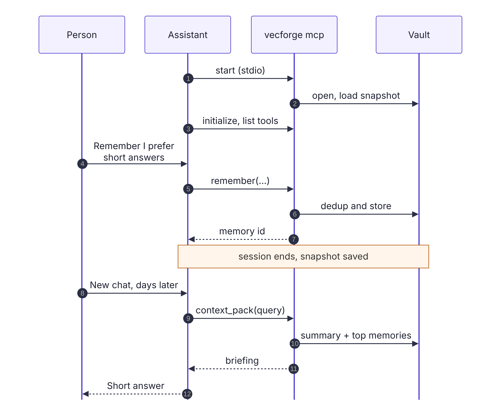{width=74%}

# Interfaces and Ingestion

**Python API.** The `VecForge` class offers `add`, `add_batch`, `upsert`, `update_metadata`, `get`, `search`, `search_batch`, `similar`, `delete`, `delete_many`, `delete_namespace`, `compact`, `reembed`, `save`, `backup` and key management. A reentrant lock serialises access, so one vault object can be shared between threads.

**REST server.** `vecforge serve` starts a FastAPI server with endpoints for adding, searching, reading, updating and deleting documents, for namespaces, statistics, saving and compaction, and for the memory layer. Requests authenticate with an `X-API-Key` header.

**Command line.** The `vecforge` command covers ingestion, search, statistics, export, serving, compaction, backup, the MCP server and memory management, so the database can be used without writing code.

**Ingestion.** `ingest()` walks a file or folder and dispatches each file by extension to a parser for plain text, Markdown, HTML, Word (DOCX) or PDF. HTML parsing drops scripts, navigation and footers. Text is split into chunks of 1,000 characters with an overlap of 200, and each chunk keeps its source path and position as metadata.

# Evaluation Method

## Research questions

The evaluation answers eight questions. Table 3 lists them with the experiments that answer each one. Experiments E1 to E7 compare VecForge 2.0 with the 1.x code; E8 to E18 measure features that are new or that need a public benchmark.

Table: **Table 3.** Research questions and experiments.

| Question | Experiments | Section |
|:------------------------------------------------------|:--------------|:--------|
| RQ1. How good is retrieval on a public benchmark, and where does query time go? | E8, E17 | 11.1 |
| RQ2. Does the reranker preserve the ranking, and what does it cost? | E1, E2 | 11.2 |
| RQ3. Do constraints keep recall, and at what cost? | E4, E10, E11 | 11.3, 11.4 |
| RQ4. How expensive are indexing, reopening and encryption? | E3, E5, E9 | 11.5 |
| RQ5. How well does memory deduplication work, and how fast is memory? | E7, E13 | 11.6 |
| RQ6. How responsive are the MCP and REST interfaces? | E14, E15 | 11.7 |
| RQ7. What do security features and ingestion cost? | E12, E16 | 11.8 |
| RQ8. How does end-to-end latency scale with size and threads? | E6, E18 | 11.9 |

## Procedure

Figure 10 summarises the method. Each experiment fixes a workload, runs one or both systems on it, records a measurement, and summarises it with a stated statistic.

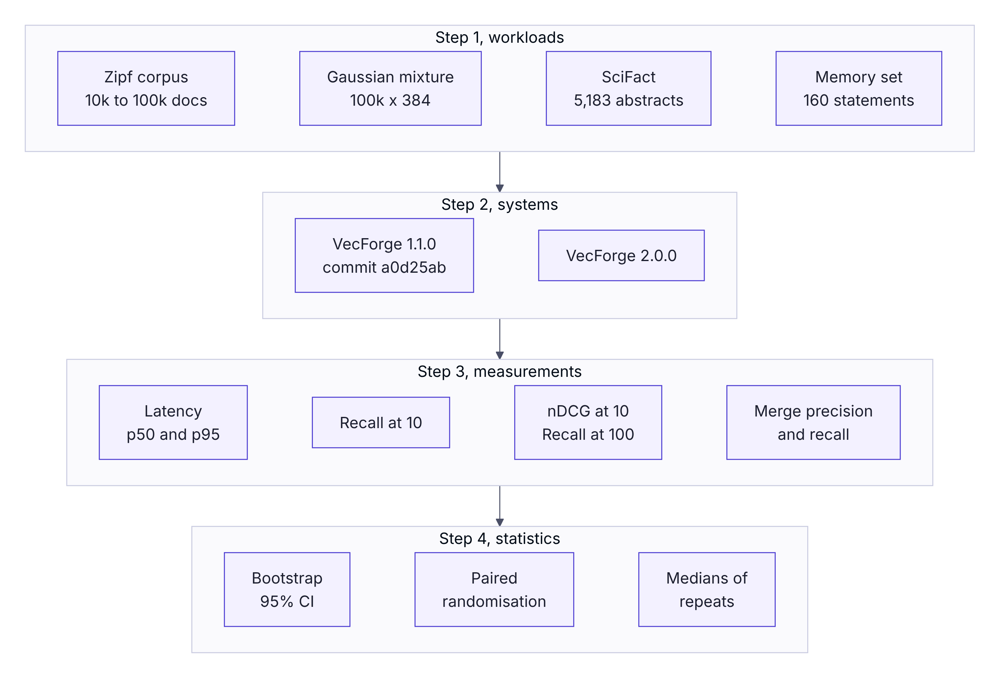{width=92%}

**Hardware and software.** All experiments ran on a 4-core virtualised Intel Xeon with 15 GB of RAM under Linux, with Python 3.13.16, NumPy 2.5.3 and FAISS 1.15.1. The 1.x baseline is the unmodified VecForge 1.1.0 code at commit `a0d25ab`.

**Workloads.** Four workloads are used. (i) A deterministic Zipf-distributed synthetic corpus of 10,000 to 100,000 documents, embedded with the 384-dimensional hash embedder, for experiments where only cost matters; it runs offline and gives identical input on every run. (ii) A Gaussian mixture of 100,000 vectors with 384 dimensions and 2,000 clusters for recall under constraints. (iii) The SciFact benchmark [@wadden2020scifact] in its BEIR form [@thakur2021beir]: 5,183 scientific abstracts, 809 training claims and 300 test claims, with the cited abstracts as relevant documents. (iv) A set of 40 hand-written facts, each with two paraphrases that should merge and one near miss that changes a single value and must not merge, for memory deduplication.

**Retrieval model.** For SciFact we use all-MiniLM-L6-v2 [@wang2020minilm], run through ONNX Runtime with mean pooling, L2 normalisation and inputs cut to 256 tokens. As a check, its dense-only nDCG@10 on SciFact in our setup is 0.645, which matches the value commonly reported for this model.

**Metrics.** Retrieval quality is measured with nDCG@10 [@jarvelin2002ndcg], Recall@100 and MRR@10. Recall under constraints is recall@10 against exact search over the allowed set. Latency is reported as the median (p50) and 95th percentile (p95) after warm-up. Deduplication is scored by the precision and recall of merges.

**Statistics.** Confidence intervals for nDCG@10 are 95% percentile bootstrap intervals over queries with 10,000 resamples [@efron1993bootstrap]. Differences between retrieval methods are tested with a two-sided paired randomisation test over queries with 10,000 permutations, as recommended for IR evaluation [@smucker2007significance]. Where a timing could drift with the state of the shared virtual machine, configurations run interleaved, in alternating order, and repeated runs report their median. Absolute latencies on this machine varied by up to about two times between sessions, so comparisons are always made within one run. The fusion weight is tuned on the training claims only, and every reported SciFact number uses the test claims.

# Results

## RQ1: Retrieval quality and where query time goes

**Fusion beats either retriever alone.** Figure 11 and Table 4 compare six configurations on the 300 SciFact test claims. Hybrid fusion with the default $\alpha = 0.5$ reaches nDCG@10 of 0.707, against 0.645 for dense retrieval alone and 0.665 for BM25 alone, a relative gain of 9.6% over dense retrieval. It also has the highest Recall@100 of the single configurations, 0.962, so fusion helps both the head of the ranking and the candidate pool that a later reranker would see. All three differences are significant (p < 0.001). Fusion also beats RRF with $k = 60$ by 0.026 nDCG@10 (p < 0.001), in line with the finding of Bruch et al. [@bruch2023fusion] that a convex combination is a strong default.

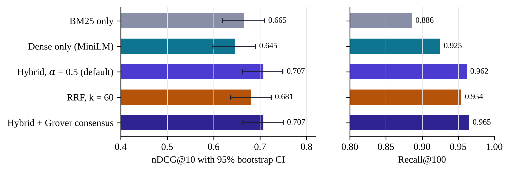{width=100%}

Table: **Table 4.** Retrieval quality on SciFact (300 test claims, all-MiniLM-L6-v2). The p-value compares each method with hybrid fusion at $\alpha = 0.5$.

| Method | nDCG@10 | 95% CI | Recall@100 | MRR@10 | p |
|:-----------------------------|--------:|:--------------:|--------:|--------:|--------:|
| BM25 only | 0.665 | 0.618 to 0.710 | 0.886 | 0.634 | < 0.001 |
| Dense only | 0.645 | 0.598 to 0.690 | 0.925 | 0.605 | < 0.001 |
| RRF, k = 60 | 0.681 | 0.637 to 0.724 | 0.954 | 0.639 | < 0.001 |
| **Hybrid, $\alpha$ = 0.5** | **0.707** | 0.663 to 0.749 | 0.962 | 0.672 | |
| Hybrid + Grover consensus | 0.707 | 0.663 to 0.750 | 0.965 | 0.672 | 0.97 |

**The default weight is a good one.** Figure 12a sweeps $\alpha$ from 0 to 1. On the training claims the best interior value is $\alpha = 0.5$, which is also the default, so the tuned configuration is the default configuration. On the test claims the curve is flat between 0.4 and 0.6 (0.707 to 0.711), and every weight from 0.1 to 0.8 beats RRF. A user who never tunes $\alpha$ therefore loses almost nothing on this benchmark.

**The Grover consensus oracle does not help here.** Adding the consensus reranker changes nDCG@10 by less than 0.0001 (p = 0.97) and raises Recall@100 slightly, from 0.962 to 0.965. On SciFact the documents found by both retrievers are already at the top of the fused list, so lifting them changes little. We report this as a negative result: the reranker is correct and cheap, but on this benchmark it does not improve retrieval quality.

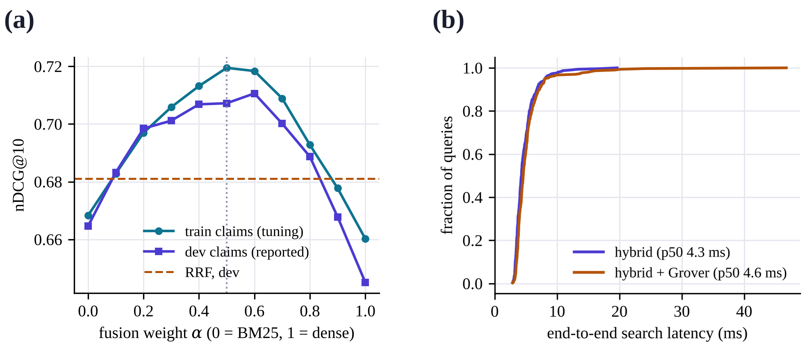{width=100%}

**Most query time is spent embedding the query.** Figure 13 breaks a SciFact query into stages, with both configurations measured on separate vault handles, interleaved query by query. Embedding the query with MiniLM takes 3.0 of the 4.8 ms of a mean hybrid query, or 62%. Hydration from SQLite takes 0.80 ms, dense search 0.46 ms, BM25 0.35 ms and fusion 0.11 ms, so all the database work together takes about 1.8 ms. Grover reranking adds 0.25 ms. End to end, the median query took 4.3 ms without reranking and 4.6 ms with it, and the 95th percentile was about 8.1 ms in both cases (Figure 12b). For a local store with a small encoder, the encoder is the main cost.

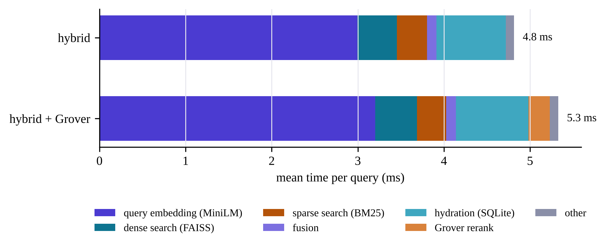{width=100%}

## RQ2: Reranker correctness and cost

**The 1.x reranker keeps or reverses; the 2.0 reranker keeps.** We feed both rerankers strictly decreasing scores for every list size $N = 2, \dots, 256$ and measure Kendall's $\tau$ [@kendall1938] between input and output order (Figure 14). The 1.x reranker returns the input order for 127 of the 255 sizes ($\tau = 1$) and the exact reverse for the other 128 ($\tau = -1$), with no other outcome, as Proposition 1 predicts. With random scores (20 trials per size) the best candidate stayed first in only 49.8% of cases and the mean $\tau$ was $-0.004$. VecForge 2.0 kept the best candidate first and returned $\tau = 1$ for every size and every trial. When a random 10% of candidates is marked, for $N$ from 20 to 1,000, all marked candidates move to the top in their original relative order.

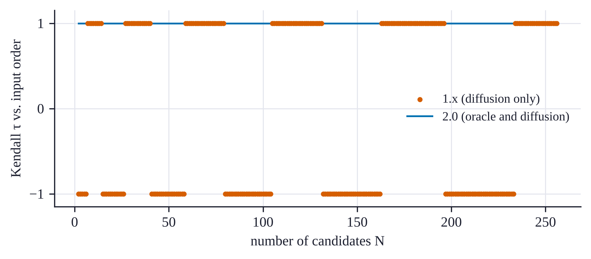{width=92%}

**The closed form removes the dependence on the iteration count.** Table 5 compares the closed form of Proposition 2 with applying the Grover iteration step by step. With the default oracle, which marks about $\sqrt{N}$ candidates, few iterations are needed and the closed form is at most 1.6 times faster. With a single marked candidate the iteration count grows as $(\pi/4)\sqrt{N}$, reaching 248 at $N = 100{,}000$, and the closed form is 9.5 times faster because its cost does not depend on the number of iterations. The full reranker selects a window of at most 1,000 candidates in linear time, so reranking a million candidates takes 2.1 ms at the median. On SciFact the reranking stage adds 0.25 ms per query (Figure 13).

Table: **Table 5.** Grover amplification cost (ms, p50); $k$ is the number of Grover iterations. Columns 2 to 4 use the default oracle (about $\sqrt{N}$ marked), columns 5 to 7 a single marked candidate. The last column is the full reranker with a 1,000-candidate window.

| $N$ | $k$ | closed | iterative | $k$ | closed | iterative | full reranker |
|---:|---:|---:|---:|---:|---:|---:|---:|
| 1,000 | 4 | 0.026 | 0.026 | 24 | 0.024 | 0.113 | 0.11 |
| 10,000 | 7 | 0.073 | 0.115 | 78 | 0.066 | 0.760 | 0.15 |
| 100,000 | 13 | 2.22 | 2.50 | 248 | 2.19 | 20.7 | 0.31 |
| 1,000,000 | | | | | | | 2.06 |

## RQ3: Recall within namespaces

We build a collection of 100,000 vectors with 384 dimensions from the Gaussian mixture, assign a random subset to a namespace, and measure recall@10 within the namespace against exact search over its members, for 200 queries drawn from the same mixture (Figure 15a). The 1.x strategy retrieves the global top 40 and discards other namespaces. For a namespace holding 0.1% of the vault it found 0.5% of the true neighbours, and 41% for a namespace holding 10%; it reaches full recall only when the namespace is half the vault. The 2.0 ID selector on a flat index is exact at every size, at 0.08 to 1.5 ms per query.

With an HNSW index, namespaces of up to 20,000 members use the exact subset search and reach full recall at 0.04 to 0.40 ms per query. The 50,000-member namespace uses filtered graph search and reaches a recall of 0.83 at efSearch = 256 (0.46 at 64). Unfiltered search over the same index reaches 0.85 at efSearch = 256 (0.49 at 64), so filtering costs almost no recall beyond what the graph itself loses. This index was built with efConstruction = 80 to keep the experiment short; the default of 200 gives a better graph.

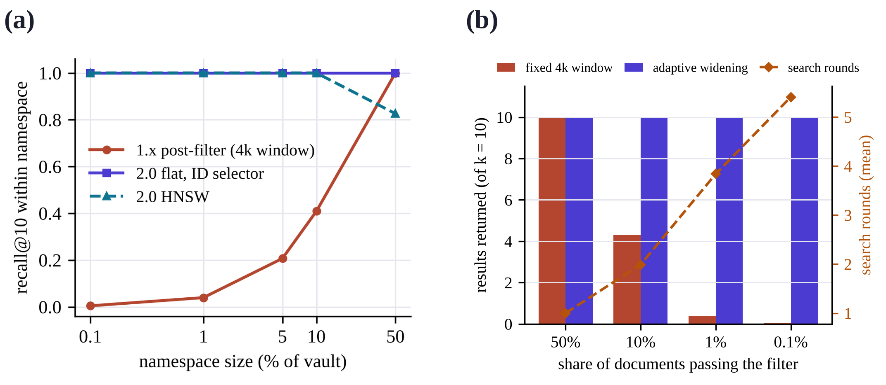{width=100%}

## RQ3: Metadata filters and deletions

**Adaptive widening always fills the result list, but rare filters are slow.** We attach a bucket number from 0 to 999 to each of 50,000 documents and filter on buckets that pass 50%, 10%, 1% and 0.1% of the documents. Figure 15b and Table 6 show the outcome. A fixed window of $4k$ candidates, as in 1.x, returns on average 4.3 of 10 results at 10% selectivity, 0.39 at 1% and 0.04 at 0.1%. Adaptive widening returns all 10 results at every selectivity. The price is latency. At 1% selectivity a query needs 3.8 rounds on average and takes 102 ms at the median; at 0.1% it needs 5.4 rounds, takes 583 ms at the median and 4.4 s at the 95th percentile, because each round hydrates and filters more rows. Highly selective filters would be better served by a metadata index that computes the allowed set before retrieval, as namespaces already do. We leave this to future work.

Table: **Table 6.** Metadata filters on 50,000 documents, top 10, 100 queries.

| Share passing | Results, fixed window | Results, adaptive | Rounds (mean) | p50 (ms) | p95 (ms) |
|---:|---:|---:|---:|---:|---:|
| 50% | 10.0 | 10.0 | 1.0 | 3.6 | 9.3 |
| 10% | 4.3 | 10.0 | 2.0 | 11.8 | 29.8 |
| 1% | 0.39 | 10.0 | 3.8 | 102 | 219 |
| 0.1% | 0.04 | 10.0 | 5.4 | 583 | 4,359 |

**Deleted documents never come back, and compaction is cheap enough.** We delete random documents from a vault of 50,000 in steps until 25% are gone (Figure 21a). No deleted document appeared in any result at any step. A delete cost 0.16 to 0.23 ms per document. As tombstones accumulated, the median search latency rose from 6.9 ms with no deletes to 9.6 ms with 19% deleted, because the flat index still visits excluded positions before the selector rejects them. The next step crossed the 20% threshold and triggered compaction, which rebuilt the indexes from the stored vectors. That step took 9.6 s in total, after which the median search fell to 4.1 ms, below its starting value, because the index had shrunk by a quarter. Compaction is therefore a short, occasional pause that pays for itself in query time.

## RQ4: Indexing, reopening and encryption

**Incremental BM25.** The 1.x BM25 index rebuilt itself from the whole corpus on every insert, so inserting $n$ documents one at a time costs $O(n^2)$ token operations. Figure 16a shows the measured cost. Inserting 2,000 documents took 24.9 s with the 1.x index and 0.14 s with the incremental index, 183 times less; 4,000 documents took 0.48 s, while the 1.x run at that size was skipped because it grows quadratically. Queries are also faster, because the incremental index scores only the postings of the query terms: 0.15 against 5.30 ms at 10,000 documents (35 times) and 1.32 against 90.1 ms at 100,000 (69 times). The two indexes use different IDF variants and tokenisers, so their top-10 results overlap by 69 to 74%; this experiment compares cost, not identical output.

**Snapshots.** Figure 16b and Table 7 compare opening a vault from its snapshot with rebuilding its indexes from the stored vectors. The snapshot makes reopening 9 to 17 times faster, which matters most for MCP sessions, where the assistant waits for the server to start. The cost is disk space: the snapshot stores a second copy of the vectors and the keyword index, and at 100,000 documents the file was 447 MB, about 2.9 times the 154 MB of raw embeddings.

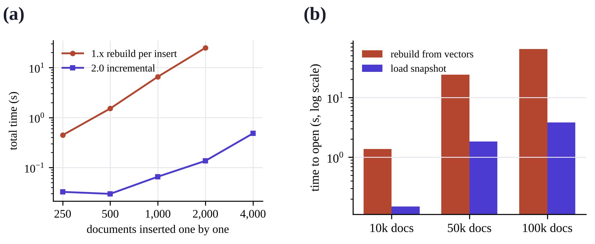{width=100%}

Table: **Table 7.** Ingest throughput and time to open a vault (median of three opens), hash embedder.

| Documents | Ingest (docs/s) | Open from snapshot (s) | Open with rebuild (s) | Speed-up |
|---:|---:|---:|---:|---:|
| 10,000 | 1,986 | 0.15 | 1.37 | 9.1 times |
| 50,000 | 1,795 | 1.82 | 24.0 | 13.2 times |
| 100,000 | 1,707 | 3.80 | 64.3 | 16.9 times |

**Encryption.** Figure 17 compares a plain vault with a SQLCipher vault of 20,000 documents, each built three times in alternating order after a warm-up. Encryption added 0.29 ms (12%) to the median search, from 2.35 to 2.64 ms, and 0.5% to the file size. Ingest throughput and opening time showed no cost that rose above the spread between runs: plain ingestion ranged from 2,192 to 3,613 documents per second across the three runs and encrypted ingestion from 3,022 to 3,712, and opening took 0.71 and 0.67 s. Page encryption is cheap here because most query work happens in the in-memory indexes, and the file is read mainly to hydrate the final rows.

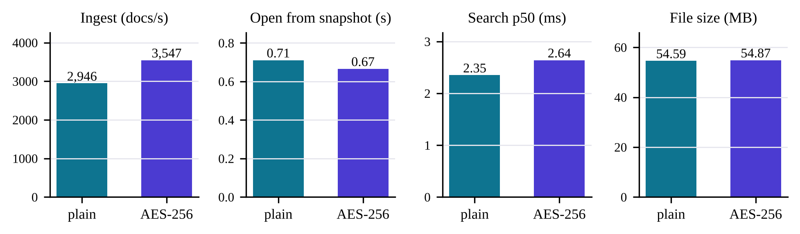{width=100%}

## RQ5: Agent memory

**Cosine similarity cannot tell a paraphrase from a changed fact.** Figure 18 (left) shows the MiniLM cosine similarity between each stored fact and its paraphrases and near misses. The two distributions overlap almost completely: the median paraphrase scores 0.823 and the median near miss 0.852. A near miss such as "The project deadline is 2 April" for the stored fact "The project deadline is 14 March" is, to the encoder, often closer than a genuine rewording such as "We have to deliver the project by 14 March". No threshold separates them (Figure 18, right). At the default of 0.92, merges have a precision of 0.56 and a recall of 0.11. Run end to end through `MemoryStore`, the default merged 10 of 80 paraphrases and 7 of 40 near misses. Each false merge reinforces the old memory and drops the new value, which is the worst outcome for a memory: the assistant keeps the outdated fact with more confidence.

We tested a simple mitigation outside the library: refuse to merge when the two statements differ in a number, a capitalised word or a negation. This guard raises merge precision to 1.0 at the default threshold and blocks 33 of 40 near misses at any threshold, but it also blocks 40 of 80 paraphrases, so recall falls to 0.09. Better deduplication needs a model trained to detect contradiction, or a confirmation step in the client. Until then, a lower threshold is not a fix, because it merges more near misses as well as more paraphrases.

{width=100%}

**Memory operations are fast.** Writing the first 1,000 memories one call at a time ran at 1,697 memories per second, and the next 4,000 at 908 per second, because each write searches for duplicates. A `recall()` took 1.95 ms with 1,000 memories and 2.49 ms with 5,000, and a full `context_pack()` briefing 2.12 and 2.68 ms (Table 8).

## RQ6: MCP and REST interfaces

We start the MCP server as a subprocess with the official MCP client over stdio, as a desktop assistant would, and time it from process start to the first tool result. With an empty vault and with 5,000 memories this took 0.71 and 0.72 s (median of three starts); the snapshot makes the size of the store almost irrelevant. Once running, tool calls took 2.0 to 4.2 ms at the median, including JSON-RPC encoding and the pipe (Figure 19, Table 8). The REST server, called over HTTP on the same machine with a 10,000-document vault, answered a search in 5.6 ms, an insert in 1.9 ms and a health check in 1.2 ms at the median. In both cases the transport adds about 1 to 3 ms over a direct library call, far below what a person or an assistant would notice.

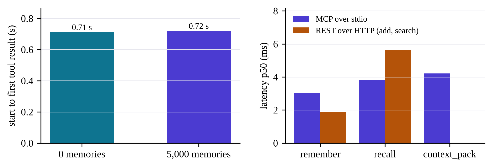{width=100%}

Table: **Table 8.** Memory and interface latency (ms, p50). For `remember` in the library columns the value is the mean time per call, derived from write throughput.

| Operation | Library, 1,000 memories | Library, 5,000 memories | MCP, empty | MCP, 5,000 memories |
|:---------------|---------:|---------:|---------:|---------:|
| `remember` | 0.59 | 1.10 | 1.99 | 3.01 |
| `recall` | 1.95 | 2.49 | 2.29 | 3.83 |
| `context_pack` | 2.12 | 2.68 | 1.95 | 4.22 |

## RQ7: Security overhead and ingestion

**Security features cost almost nothing.** Table 9 compares search and insert latency on 10,000 documents with no security features, with the audit log, with an API key in the read-write role, and with both. All differences are within 0.4 ms of the baseline and do not grow with the number of features, so they are within the noise of the machine. Checking a role is a dictionary lookup and an audit entry is one buffered line of JSON.

Table: **Table 9.** Cost of security features (ms, p50, 10,000 documents).

| Configuration | Search | Add |
|:---|---:|---:|
| Local admin, no audit | 1.62 | 0.31 |
| Audit log on | 1.66 | 0.35 |
| API key, read-write role | 1.97 | 0.32 |
| Audit log and API key | 1.77 | 0.36 |

**Ingestion speed depends on the file format.** We ingest the same 60 documents of about 3,900 characters each, written as plain text, Markdown, HTML, DOCX and PDF (Figure 20). Each value is the median of three runs after a discarded warm-up pass. Plain text, Markdown, HTML and PDF all ingest at 0.70 to 0.82 million characters per second, so parsing these formats costs little beyond chunking and indexing. DOCX is the outlier at 0.30 million characters per second, 2.7 times slower than plain text, because each file is a ZIP archive of XML that must be unpacked and parsed. With the hash embedder this measures the parsers and the database. With a neural embedder, embedding dominates: SciFact abstracts were ingested at 23 documents per second with MiniLM on the same machine.

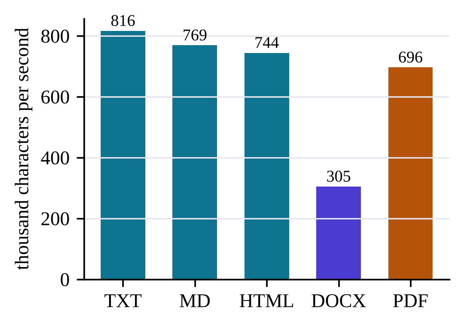{width=62%}

## RQ8: Scaling with size and threads

**End-to-end latency.** Table 10 reports full `search()` calls on the synthetic corpus: query embedding, dense and sparse retrieval, fusion, hydration and, where enabled, reranking. The three modes run interleaved, in rotating order, and every query string is unique so the embedding cache never hits. The quantum-inspired rerank adds 0.3 to 0.6 ms. A namespace holding half the vault costs about 9 to 11 ms more at 100,000 documents, because the allowed set is materialised and both retrievers are scored against it. At this scale the sparse retriever and hydration dominate, so HNSW and flat search take about the same time end to end.

Table: **Table 10.** End-to-end search latency on the synthetic corpus (ms, p50 and p95 over 200 queries, top 10, hash embedder).

| Documents | Index | Hybrid | With namespace (50%) | With Grover rerank |
|---:|:---|---:|---:|---:|
| 10,000 | flat | 1.6 and 4.0 | 2.2 and 3.1 | 1.8 and 8.4 |
| 100,000 | flat | 12.5 and 22.8 | 21.3 and 33.4 | 13.1 and 25.9 |
| 100,000 | HNSW | 12.1 and 43.9 | 22.6 and 76.7 | 12.4 and 48.6 |

**Threads.** We run 400 unique searches over a 50,000-document vault from 1, 2, 4 and 8 threads that share one vault object, three times in rotating order (Figure 20b). Throughput rose from a median of 112 queries per second with one thread to 153 with two and stayed between 141 and 153 with four and eight. The spread between runs was large, up to 50 queries per second, so only the plateau is clear. The vault's lock serialises the core of each search, so extra threads mainly overlap the work done outside it. Concurrency did not change results: for 200 queries, eight threads returned exactly the same top-10 lists as one thread. Read-heavy services can run one vault handle per worker process, at the cost of one copy of the indexes per process; parallel search inside one vault is future work.

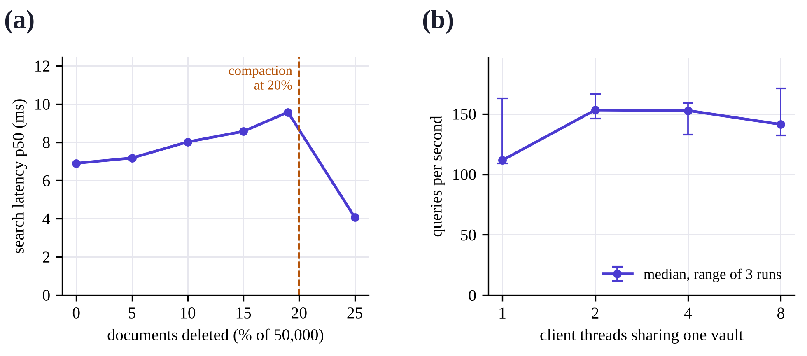{width=100%}

# Discussion and Limitations

**What the results say.** Hybrid fusion is the feature with the clearest effect on quality: on SciFact it beats both retrievers alone and RRF by a significant margin with no tuning. In-index constraints, incremental indexing and snapshots fix the three structural problems of 1.x, with gains of one to two orders of magnitude. Encryption, access control and audit logging cost little enough that there is no reason to leave them off. The interfaces add only a few milliseconds.

**Negative results.** Three results do not favour the design, and we think they are as useful as the positive ones. First, the Grover consensus reranker is correct and cheap but did not change nDCG on SciFact; its value is a principled, order-preserving way to promote a chosen subset, not a quality gain on this benchmark. Second, filters that pass 0.1% of documents take hundreds of milliseconds, because they are applied after retrieval. Third, cosine-based memory deduplication merges statements that differ in a single value, which silently replaces a new fact with an old one. Fourth, a shared vault object does not scale beyond about two threads, because its lock serialises the core of each search.

**What "quantum-inspired" means here.** The reranker is a classical algorithm that borrows the algebra of amplitude amplification. It runs on ordinary CPUs, offers no quantum speed-up, and its effect is fully determined by the oracle. We believe the analysis in Section 6 is useful precisely because "Grover-inspired" components can look plausible while doing nothing, or harm.

**Scale and scope.** VecForge targets one machine and up to a few million vectors. It does not shard, replicate or serve concurrent writers from several processes, and one vault object serialises its operations with a lock. Snapshots trade disk space for reopening time.

**Threats to validity.** All timings come from one shared virtual machine, whose speed varied by up to two times between sessions; we compare configurations only within a run, interleave them where drift could bias the result, and report medians. Retrieval quality is measured on one dataset with one encoder; other domains, longer documents or stronger encoders may favour a different fusion weight or a different method. The deduplication set is small (160 statements) and was written for this study, so its numbers indicate the size of the problem rather than an exact error rate. The systems experiments use a feature-hashing embedder so that they run offline and deterministically; a neural embedder adds its own inference time to every query and every insert, as the SciFact breakdown shows.

**Licence.** VecForge is distributed under the Business Source License 1.1. The source is public, and personal, research and non-commercial use is free; commercial use requires a licence. It is source-available rather than open source in the OSI sense.

# Conclusion and Future Work

VecForge 2.0 shows that an embedded vector database can offer hybrid retrieval with in-index constraints, encrypted storage that reopens without re-indexing, access control, and a persistent, standards-based memory for AI assistants, all inside one Python process and one file. On SciFact its default hybrid configuration improves nDCG@10 by 9.6% over dense retrieval and beats reciprocal rank fusion. Along the way we found and corrected a reranker that applied only half of Grover's algorithm, proved why that half alone can only keep or reverse a ranking, and replaced it with an O(N) closed form of the full algorithm that preserves order within the marked and unmarked sets.

Three directions follow from the negative results. A metadata index that computes the allowed set before retrieval would make selective filters as fast as namespaces. A contradiction-aware deduplication step, or a confirmation request through MCP, would stop false merges in agent memory. And an evaluation of the consensus oracle and of cross-encoder reranking on the full BEIR suite would show where amplification helps, if anywhere. The system, the experiments and this paper's data generators are publicly available.

# Availability

- Install: `pip install vecforge` (version 2.0.0), or `pip install "vecforge[mcp]"` for the MCP server.
- Source, documentation and experiments: <https://github.com/bosekarmegam/vecforge>. The scripts `paper/experiments/run_experiments.py` (E1 to E7) and `paper/experiments/run_experiments2.py` (E8 to E18) produce every number in this paper, and their raw output is released as `results.json` and `results2.json`.
- Documentation website: <https://bosekarmegam.github.io/vecforge/>.

# References {.unnumbered}

::: {#refs}
:::
