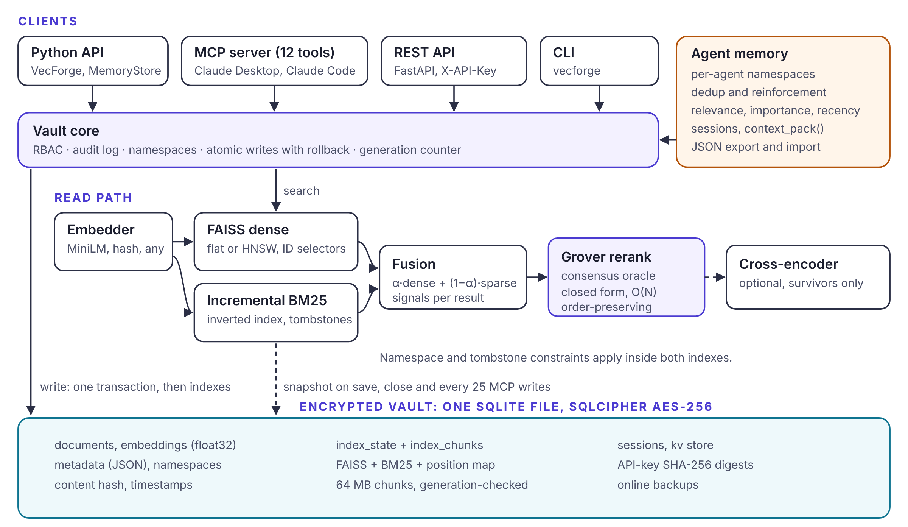
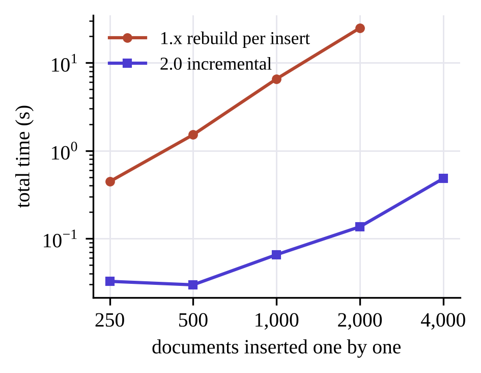
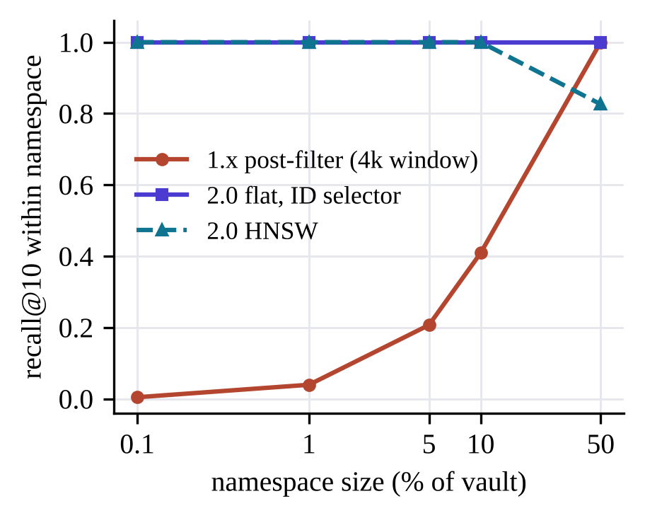

# Introduction

Large language models (LLMs) answer better when they can retrieve relevant context at inference time [@lewis2020rag]. In practice this requires a vector store: a system that embeds documents, indexes the vectors for approximate nearest-neighbour search, and returns the closest matches to a query. Most production vector databases are network services, either hosted [@pinecone] or self-managed [@wang2021milvus]. That model fits large shared deployments, but it is a poor fit for three growing groups of users: developers who want retrieval inside a single Python process, organisations whose data may not leave the machine for privacy or regulatory reasons, and AI assistants that need a private, durable memory of the person they work with.

The third group is new. Assistants such as Claude can now call local tools through the Model Context Protocol (MCP) [@mcp2024]. A local memory store reachable over MCP lets an assistant remember a preference stated on Monday when a new conversation starts on Friday, without that memory ever leaving the user's computer. Prior work on agent memory, such as the memory stream of Generative Agents [@park2023generative] and the hierarchical memory of MemGPT [@packer2023memgpt], establishes that relevance, importance and recency all matter when deciding what an agent should recall. These systems describe memory architectures; they do not provide an embeddable, encrypted store with a standard tool interface.

VecForge is an embedded, local-first [@kleppmann2019localfirst] vector database for Python. Its first public releases (1.0 and 1.1) combined FAISS [@johnson2019faiss; @douze2024faiss] dense search, BM25 keyword search [@robertson2009bm25], SQLCipher encryption [@sqlcipher] and a "quantum-inspired" reranker motivated by Grover's search algorithm [@grover1996]. An audit of the 1.x code for this work found three structural problems. Namespace isolation was implemented as a post-filter over a fixed window of $4k$ candidates, so a small namespace in a large vault lost most of its true neighbours. The BM25 index was rebuilt from the full corpus on every insert, making ingestion quadratic. And the reranker applied Grover's diffusion operator without its oracle, which we show reverses or preserves the input ranking depending only on the parity of the iteration count.

This paper describes VecForge 2.0, which redesigns these components, and makes the following contributions:

1. **A hybrid retrieval engine with in-index constraints.** Namespace scoping and deletions are applied inside FAISS through ID selectors, with an exact fallback for small subsets of HNSW indexes [@malkov2020hnsw], so scoped queries keep full recall. An incremental inverted-index BM25 replaces per-insert rebuilds.
2. **Fast, safe reopening.** Index state is serialised into the encrypted vault in chunks and validated against a generation counter, so an unchanged vault reopens without re-indexing.
3. **Persistent agent memory over MCP.** A memory layer with typed memories, near-duplicate reinforcement, sessions and a recall score that blends relevance, importance and recency, served to MCP clients through twelve tools.
4. **An analysis and correction of Grover-inspired reranking.** We prove that diffusion-only reranking is an involution that either reverses or preserves the ranking, confirm this on 255 list sizes, and give an O(N) closed-form implementation of oracle-plus-diffusion amplitude amplification [@brassard2002amplitude] that preserves order within the marked and unmarked sets.
5. **A reproducible evaluation** of every component against the 1.x code, on commodity hardware, with the scripts released alongside the system.

Section 2 reviews related work. Section 3 describes the architecture. Section 4 analyses the reranker. Section 5 presents the memory layer. Section 6 reports the evaluation, Section 7 discusses limitations, and Section 8 concludes.

# Background and Related Work

**Vector search.** FAISS provides exact and approximate nearest-neighbour indexes on CPU and GPU [@johnson2019faiss; @douze2024faiss], including product quantisation [@jegou2011pq] and Hierarchical Navigable Small World (HNSW) graphs [@malkov2020hnsw]. Purpose-built vector databases such as Milvus [@wang2021milvus] add storage, filtering and distribution on top of such indexes. Embedded stores trade scale for simplicity: the database is a library and a file. VecForge belongs to this second group and uses FAISS for indexing and SQLite for durable storage.

**Hybrid retrieval.** Lexical retrieval with BM25 [@robertson2009bm25] remains a strong baseline, and combining it with dense retrieval is often better than either alone [@thakur2021beir]. Common fusion functions are reciprocal rank fusion (RRF) [@cormack2009rrf] and a convex combination of normalised scores. Bruch et al. [@bruch2023fusion] analyse both and find that a tuned convex combination is competitive with or better than RRF and is more sample-efficient to tune. VecForge uses a convex combination of min-max normalised scores; its hybrid module also provides RRF as a standalone function. Cross-encoder rerankers [@nogueira2019passage] over sentence embeddings [@reimers2019sbert; @wang2020minilm] can refine the final list.

**Agent memory.** Generative Agents [@park2023generative] retrieve memories by a weighted sum of recency, importance and relevance. MemGPT [@packer2023memgpt] manages a hierarchy of in-context and external memory. Both inform VecForge's recall score; our contribution is an engineering one: an encrypted, embeddable store with per-agent isolation, deduplication and a standard tool interface through MCP [@mcp2024].

**Quantum-inspired retrieval.** Grover's algorithm finds a marked item among $N$ in $O(\sqrt{N})$ queries by alternating an oracle, which flips the phase of marked states, with a diffusion operator, which reflects about the mean [@grover1996]. Amplitude amplification generalises this to arbitrary initial states [@brassard2002amplitude]. Classical "quantum-inspired" algorithms borrow such structure to obtain useful classical procedures [@tang2019quantuminspired]. In ranking, the appeal is that amplification concentrates probability mass on a chosen subset. As we show in Section 4, the oracle is not optional: without it, the diffusion step alone carries no information about which items to favour.

# System Design

Figure 1 shows the architecture. A VecForge *vault* is one SQLite file, optionally encrypted with SQLCipher (AES-256, page-level). The vault holds documents, vectors, metadata, namespaces, API-key digests, agent sessions, a key-value table, and serialised index state. In memory, a vault keeps a FAISS index over all vectors and a BM25 inverted index over all text.

{#fig:arch width=100%}

## Storage and transactions

Schema version 2 stores each document's text, embedding (as a float32 blob), metadata (JSON), namespace, timestamps and a content hash. Writes are atomic: a batch insert is one SQLite transaction, and if updating the in-memory indexes fails afterwards, the rows are deleted and the indexes rebuilt, so the file and the indexes never disagree. Embedding dimensions are checked before anything is written. An `upsert` replaces a document in a single transaction. A monotonically increasing *generation* counter is bumped by every write that changes text or vectors; metadata-only updates do not bump it, because they do not affect the indexes.

## Dense retrieval with in-index constraints

Each vector's position in the FAISS index is mapped to a document identifier. Deletions are *tombstones*: the position is added to an exclusion set rather than removed from the index, which makes a delete O(1). When tombstones exceed 20% of the index (and at least 1,000 entries), the vault compacts by rebuilding from stored vectors.

Queries restrict the search space inside FAISS. A namespace query builds an `IDSelectorBatch` over the namespace's live positions, combined with an `IDSelectorNot` over the tombstones; the selector is passed through FAISS search parameters, so the index only scores allowed vectors. For a flat (exact) index this yields exact results within the namespace. For an HNSW index, graph search under a very restrictive selector can miss allowed neighbours, because the graph's routing passes through excluded nodes. VecForge therefore searches exactly over the reconstructed vectors of the allowed subset when it has at most 20,000 members, and otherwise uses filtered graph search with a widened `efSearch`. The index type is `flat`, `hnsw` (M = 32, efConstruction = 200, efSearch = 64) or `auto`, which switches to HNSW above 50,000 vectors.

Metadata filters (equality, ranges, membership, containment and existence operators) are evaluated on hydrated candidates. Because a filter may reject most candidates, the candidate window starts at $\max(4k, 20)$ and grows by a factor of four until $k$ results pass or the whole pool has been examined.

## Incremental BM25

The keyword index is an inverted index from term to a growable postings array of (document position, term frequency) pairs, with per-document lengths. Adding a document appends to the postings of its terms in $O(|d|)$ time. Scoring uses Okapi BM25 [@robertson2009bm25] with $k_1 = 1.5$, $b = 0.75$ and the non-negative IDF

$$\mathrm{idf}(t) = \ln\!\left(1 + \frac{N - n_t + 0.5}{n_t + 0.5}\right),$$

where $N$ is the number of live documents and $n_t$ the number containing $t$. A query touches only the postings of its terms. Deletions are tombstones in the same position space as FAISS, and namespace selectors restrict BM25 scoring to the same allowed set. The index serialises to NumPy arrays without Python pickling, so loading a snapshot cannot execute code.

## Fusion

Let $D$ and $S$ be the dense and sparse candidate sets with raw scores $s_d$ and $s_s$. Each score list is min-max normalised over its candidates, and the fused score is

$$f(x) = \alpha\,\hat{s}_d(x) + (1-\alpha)\,\hat{s}_s(x), \qquad \alpha \in [0,1],$$

with a missing score treated as zero and $\alpha = 0.5$ by default. Each result records which retrievers found it (`dense`, `sparse` or both) and both raw scores, so applications can explain a ranking. Ties break on the fused score, then on the number of retrievers that found the document, then on the raw dense score, which makes results deterministic.

## Snapshots and reopening

On `save()` and `close()`, and periodically during long sessions, the vault serialises the FAISS index, the BM25 arrays and the position map, splits the bytes into chunks of at most 64 MB, and stores them in an `index_state` table together with the generation at which they were taken. On open, if the stored generation equals the current one, the indexes are loaded directly. Otherwise the vault rebuilds them from the stored vectors, which never requires re-embedding. Because snapshots live inside the vault, they are encrypted whenever the vault is.

## Security

Access control has three roles. `admin` may do everything, including managing keys and reading raw storage; `read-write` may add, update and delete; `read-only` may search and read. API keys are stored as SHA-256 digests. A key that has not been registered has no access (in 1.x it received read-only access). Opening a vault without a key gives local admin rights, which keeps single-user use simple. An optional audit log records every operation as one JSON line. The REST server binds to localhost by default and compares API keys in constant time.

# Grover-Inspired Reranking

## Setting

Given $N$ candidates with non-negative relevance scores $r_1 \ge r_2 \ge \dots \ge r_N$, the reranker encodes them as a unit amplitude vector $a = r / \lVert r \rVert_2$, so that $a_i^2$ is a probability. Grover's algorithm acts on such a state with two reflections. The *oracle* $O_M$ flips the sign of the amplitudes in a marked set $M$:

$$(O_M a)_i = \begin{cases} -a_i & i \in M \\ a_i & i \notin M. \end{cases}$$

The *diffusion* operator is the reflection about the uniform state $s = \tfrac{1}{\sqrt{N}}\mathbf{1}$:

$$D = 2ss^{\top} - I, \qquad (Da)_i = 2\bar{a} - a_i, \quad \bar{a} = \tfrac{1}{N}\textstyle\sum_j a_j .$$

One Grover iteration is $G = D\,O_M$. With $\sin\theta = \sqrt{|M|/N}$, $G$ rotates the component of the state in the plane spanned by the uniform vectors over $M$ and over its complement by $2\theta$ towards $M$ [@grover1996; @brassard2002amplitude].

## Diffusion alone is an involution

The 1.x reranker applied $D$ alone, $k$ times, with $k = \lfloor \pi / (4 \arcsin(1/\sqrt{N})) \rfloor$, and ranked candidates by the result.

**Proposition 1.** *$D^2 = I$. Hence $D^k a = a$ for even $k$ and $D^k a = Da$ for odd $k$. Moreover, $Da$ is a strictly decreasing function of $a$ coordinate-wise, so ranking by $Da$ exactly reverses the ranking by $a$.*

*Proof.* $D^2 = 4ss^{\top}ss^{\top} - 4ss^{\top} + I = I$ because $s^{\top}s = 1$. For odd $k$, $(Da)_i = 2\bar{a} - a_i$, and $a_i > a_j$ implies $(Da)_i < (Da)_j$. $\square$

The reranker therefore carries no information beyond the parity of $k$: it either leaves the ranking unchanged or reverses it, and which one happens depends only on $N$. Section 6.1 confirms this on 255 list sizes: the 1.x code reversed the ranking for 50.2% of them and left it unchanged for the rest, with no other outcome. Applying $D$ alone cannot "amplify" relevant items, because nothing tells it which items are relevant. That information is the oracle.

## Oracle and diffusion in closed form

VecForge 2.0 applies $G = D\,O_M$. Running $G$ step by step costs $O(kN)$ with $k = O(\sqrt{N/|M|})$, but $G^k$ has a closed form that costs $O(N)$ regardless of $k$. Write $m = |M|$, let $u_M$ and $u_U$ be the unit uniform vectors over $M$ and its complement $U$, and decompose

$$a = \alpha_0\,u_M + \beta_0\,u_U + \rho_M + \rho_U,$$

where $\alpha_0 = \tfrac{1}{\sqrt{m}}\sum_{i\in M} a_i$, $\beta_0 = \tfrac{1}{\sqrt{N-m}}\sum_{i \in U} a_i$, and $\rho_M$, $\rho_U$ are the zero-mean residuals within each set. The residuals are orthogonal to $u_M$, $u_U$ and $s$.

**Proposition 2.** *Let $\phi_0 = \operatorname{atan2}(\alpha_0, \beta_0)$, $R = \sqrt{\alpha_0^2 + \beta_0^2}$ and $\phi_k = \phi_0 + 2k\theta$. Then*

$$G^k a = R\sin\phi_k\,u_M + R\cos\phi_k\,u_U + \rho_M + (-1)^k \rho_U .$$

*Proof.* On the plane spanned by $u_M, u_U$, $O_M$ reflects across $u_U$ and $D$ reflects across $s = \sin\theta\,u_M + \cos\theta\,u_U$; their product is a rotation by $2\theta$. A residual $\rho$ is orthogonal to $s$, so $D\rho = -\rho$. $O_M$ negates $\rho_M$ and fixes $\rho_U$. Hence $G\rho_M = D(-\rho_M) = \rho_M$ and $G\rho_U = D\rho_U = -\rho_U$. $\square$

The optimal iteration count rotates the state as close as possible to $u_M$: $k^\star = \operatorname{round}\big((\pi/2 - \phi_0)/(2\theta)\big)$. In coordinates, a marked amplitude becomes $a_i + (R\sin\phi_k - \alpha_0)/\sqrt{m}$, so **every marked amplitude is shifted by the same constant**, and the marked set keeps its original order. Unmarked amplitudes become $R\cos\phi_k/\sqrt{N-m} \pm (a_i - \bar{a}_U)$, whose order flips when $k$ is odd. Rather than expose that artefact, VecForge keeps the amplified probability mass of the unmarked set and redistributes it in proportion to the original probabilities, so the unmarked set also keeps its order. The final scores are max-normalised to $[0, 1]$.

## Choosing the oracle

The marked set decides what the reranker does. With no external signal, VecForge marks the top $\max(k, \lceil K^{1/2} \rceil)$ candidates of a window of $K \le 1000$ (the default top-$\sqrt{K}$ oracle); this keeps the full order and sharpens the score gap between the head and the tail. Inside hybrid search, VecForge uses a *consensus oracle*: it marks the candidates that both the dense and the sparse retriever returned. Amplification then lifts documents on which the two retrievers agree above documents found by only one, while keeping each group's internal order. An optional cross-encoder then runs only on the survivors. The window is selected with an $O(N)$ partial sort, so the whole reranker costs $O(N + K)$.

# Persistent Memory for AI Agents

The memory layer stores *memories*, short texts with a kind (fact, preference, decision, task, event or note), an importance in $[0,1]$, tags, an optional session, and timestamps. Each agent writes into its own namespace, so agents sharing a vault cannot read or delete each other's memories.

**Writing.** `remember()` first checks for an exact duplicate by content hash and then for a near-duplicate by cosine similarity (threshold 0.92) among memories of the same kind. A duplicate is *reinforced* instead of stored again: its importance rises by 0.05 (and never falls below the importance given to the new copy), its tags are merged, and its access count is incremented. This keeps the memory compact as an assistant restates the same facts across conversations.

**Recall.** `recall()` retrieves candidates with the hybrid retriever and scores each memory as

$$\mathrm{score}(m) = (1 - w_r - w_i)\,\mathrm{rel}(m) + w_i\,\mathrm{imp}(m) + w_r\,2^{-\Delta t / h},$$

with $w_i = 0.25$, $w_r = 0.15$, a half-life $h$ of 30 days, and $\Delta t$ the time since the memory was last used. This follows the relevance-importance-recency decomposition of Generative Agents [@park2023generative]. Recall can be restricted by kind, tag, minimum importance and age.

**Sessions.** A session groups the memories written during one conversation and ends with a summary. `context_pack()` assembles a briefing for the start of a new conversation: the last session's summary followed by the most relevant memories, cut to a character budget.

**MCP interface.** `vecforge mcp` exposes the memory layer to MCP clients [@mcp2024] over stdio (for Claude Desktop and Claude Code) or HTTP. It provides twelve tools (`remember`, `recall`, `forget`, `reinforce`, `list_memories`, `start_session`, `end_session`, `recent_sessions`, `context_pack`, `search_vault`, `add_document`, `vault_stats`), resources for recent memories, sessions and vault statistics, and a `recall_context` prompt that loads a briefing. The embedding model loads in a background thread while the client connects, and the server snapshots the index every 25 writes and at shutdown, so the next session opens without a rebuild. Tool errors are returned as readable messages rather than stack traces.

# Evaluation

We evaluate six questions on a 4-core virtualised Intel Xeon with 15 GB of RAM, running Linux, Python 3.13.16, NumPy 2.5.3 and FAISS 1.15.1. The 1.x baselines are the unmodified VecForge 1.1.0 modules, loaded from commit `a0d25ab` of the repository. Experiments that need text use a deterministic Zipf-distributed synthetic corpus and VecForge's 384-dimensional hash embedder, so they run offline and produce the same input every time; vector-level experiments use synthetic vectors. Latencies are medians (p50) after warm-up. Absolute latencies on this shared virtual machine varied by up to about 2× between runs, so each table compares configurations measured in the same run. Every number below is produced by `paper/experiments/run_experiments.py`, and the raw results are released with it.

## Does the reranker preserve the ranking?

We feed both rerankers strictly decreasing scores for every list size $N = 2, \dots, 256$, and measure Kendall's $\tau$ [@kendall1938] between the input order and the output order (Figure 2). The 1.x reranker returns the input order unchanged for 127 of the 255 sizes ($\tau = 1$) and exactly reversed for the other 128 ($\tau = -1$), with no other outcome, as Proposition 1 predicts. It kept the best candidate first for only 49.8% of sizes. With random scores (20 trials per size) the picture is the same: the best candidate stayed first in 49.8% of cases and the mean $\tau$ was $-0.004$. VecForge 2.0 kept the best candidate first and returned $\tau = 1$ for every size and every trial.

To check that amplification does something useful when it is told what to favour, we mark a random 10% of candidates for $N \in \{20, 50, 100, 500, 1000\}$, as the consensus oracle would. In every case all marked candidates moved to the top of the list, in their original relative order.

{width=96%}

## What does the reranker cost?

Table 1 compares the closed form of Proposition 2 with applying the Grover iteration step by step. With the default oracle, which marks about $\sqrt{N}$ candidates, few iterations are needed and the closed form is at most 1.6 times faster. With a single marked candidate the iteration count grows as $(\pi/4)\sqrt{N}$, reaching 248 at $N = 100{,}000$, and the closed form is 9.5 times faster because its cost does not depend on the number of iterations. End to end, the reranker first selects a window of at most 1,000 candidates in linear time, so reranking a million candidates takes 2.1 ms at the median.

Table: **Table 1.** Grover amplification cost (ms, p50); $k$ is the number of Grover iterations. Columns 2 to 4: default oracle (about $\sqrt{N}$ marked). Columns 5 to 7: a single marked candidate. Last column: end-to-end reranker with a 1,000-candidate window.

| $N$ | $k$ | closed | iterative | $k$ | closed | iterative | end to end |
|---:|---:|---:|---:|---:|---:|---:|---:|
| 1,000 | 4 | 0.026 | 0.026 | 24 | 0.024 | 0.113 | 0.11 |
| 10,000 | 7 | 0.073 | 0.115 | 78 | 0.066 | 0.760 | 0.15 |
| 100,000 | 13 | 2.22 | 2.50 | 248 | 2.19 | 20.7 | 0.31 |
| 1,000,000 | | | | | | | 2.06 |

## Incremental keyword index

The 1.x BM25 index rebuilt itself from the whole corpus on every insert, so inserting $n$ documents one at a time costs $O(n^2)$ token operations. Figure 3 shows the measured cost. Inserting 2,000 documents took 24.9 s with the 1.x index and 0.14 s with the incremental index, 183 times less; 4,000 documents took 0.48 s, while the 1.x run at that size was skipped because it grows quadratically. Queries are also faster, because the incremental index scores only the postings of the query terms (Table 2). The two indexes use different IDF variants and tokenisers, so their top-10 results overlap by 69 to 74%. This experiment therefore compares cost, not identical output.

{width=46%}

Table: **Table 2.** BM25 query latency (ms, p50 over 50 three-term queries) and top-10 overlap between the two indexes.

| Documents | 1.x | 2.0 | Speed-up | Top-10 overlap |
|---:|---:|---:|---:|---:|
| 10,000 | 5.30 | 0.15 | 35× | 74% |
| 100,000 | 90.1 | 1.32 | 69× | 69% |

## Recall within a namespace

We build a 100,000-vector, 384-dimensional collection from a Gaussian mixture with 2,000 clusters, assign a random subset to a namespace, and measure recall@10 within the namespace against exact search over its members, for 200 queries drawn from the same mixture (Figure 4). The 1.x strategy retrieves the global top 40 and discards other namespaces. For a namespace holding 0.1% of the vault it found 0.5% of the true neighbours, and 41% at 10%; it reaches full recall only when the namespace is half the vault. The 2.0 ID selector on a flat index is exact at every size, at 0.08 to 1.5 ms per query.

With an HNSW index, namespaces of up to 20,000 members use the exact subset search and reach full recall (0.04 to 0.40 ms per query). The 50,000-member namespace uses filtered graph search and reaches a recall of 0.83 at efSearch = 256 (0.46 at 64). For context, unfiltered search over the same index reaches 0.85 at efSearch = 256 (0.49 at 64), so filtering costs almost no recall beyond what the graph itself loses. This index was built with efConstruction = 80 to keep the experiment short; the product default is 200, which yields a better graph.

{width=46%}

## Reopening a vault

Table 3 compares opening a vault from its snapshot with rebuilding its indexes from the stored vectors (the snapshot is removed before each rebuild run). The snapshot makes reopening 9 to 17 times faster, which matters most for MCP sessions, where the assistant waits for the server to start. The cost is disk space: the snapshot stores a second copy of the vectors and the keyword index. At 100,000 documents the file was 447 MB, about 2.9 times the 154 MB of raw embeddings.

Table: **Table 3.** Ingest throughput and time to open a vault (median of three opens), hash embedder.

| Documents | Ingest (docs/s) | Open from snapshot (s) | Open with rebuild (s) | Speed-up |
|---:|---:|---:|---:|---:|
| 10,000 | 1,986 | 0.15 | 1.37 | 9.1× |
| 50,000 | 1,795 | 1.82 | 24.0 | 13.2× |
| 100,000 | 1,707 | 3.80 | 64.3 | 16.9× |

## End-to-end search and agent memory

Table 4 reports full `search()` calls: embedding the query, dense and sparse retrieval, fusion, hydration from SQLite and, where enabled, reranking. To keep the comparison fair, the three modes run interleaved and in rotating order, and every query string is unique so the embedding cache never hits. The quantum-inspired rerank adds 0.3 to 0.6 ms. Restricting the search to a namespace that holds half the vault costs more, about 9 to 11 ms at 100,000 documents, because the allowed set is materialised and both retrievers are scored against it. At this scale the sparse retriever and hydration dominate, so HNSW and flat search take about the same time end to end. These numbers use the hash embedder; a neural embedding model adds its own inference time to every query.

Table: **Table 4.** End-to-end search latency (ms, p50 / p95 over 200 queries, top 10).

| Documents | Index | Hybrid | + namespace (50%) | + quantum rerank |
|---:|:---|---:|---:|---:|
| 10,000 | flat | 1.6 / 4.0 | 2.2 / 3.1 | 1.8 / 8.4 |
| 100,000 | flat | 12.5 / 22.8 | 21.3 / 33.4 | 13.1 / 25.9 |
| 100,000 | HNSW | 12.1 / 43.9 | 22.6 / 76.7 | 12.4 / 48.6 |

For the memory layer, writing the first 1,000 memories one call at a time ran at 1,697 memories per second, and the next 4,000 at 908 per second. A `recall()` took 1.95 ms with 1,000 memories and 2.49 ms with 5,000, and a full `context_pack()` briefing took 2.12 and 2.68 ms. Memory operations are therefore far below the latency a person or an assistant would notice.

# Discussion and Limitations

**Retrieval quality.** This paper measures correctness, recall under constraints and efficiency. It does not report retrieval effectiveness on standard benchmarks such as BEIR [@thakur2021beir], because effectiveness depends mainly on the embedding model and the fusion weight, not on the storage engine. A systematic comparison of fusion settings and of the consensus oracle against RRF and cross-encoder reranking on BEIR is the most important next step.

**What "quantum-inspired" means here.** The reranker is a classical algorithm that borrows the algebra of amplitude amplification. It runs on ordinary CPUs, offers no quantum speed-up, and its effect is fully determined by the oracle. Its value is a principled, order-preserving way to move a chosen subset to the top and to shape the score distribution. We believe the analysis in Section 4 is useful precisely because "Grover-inspired" components can look plausible while doing nothing, or harm.

**Scale and scope.** VecForge targets one machine and up to a few million vectors. It does not shard, replicate or serve concurrent writers from several processes. Snapshots trade disk space for reopen time. The hash embedder used in parts of the evaluation is a lexical feature-hashing model chosen so that the experiments run offline and deterministically; it is not a substitute for a neural embedding model in production.

**Licence.** VecForge is distributed under the Business Source License 1.1. The source is public, and personal, research and non-commercial use is free; commercial use requires a licence. It is source-available rather than open source in the OSI sense.

# Conclusion

VecForge 2.0 shows that an embedded vector database can offer hybrid retrieval with in-index constraints, encrypted storage that reopens without re-indexing, and a persistent, standards-based memory for AI assistants, all inside a single Python process. In the process, we found and corrected a reranker that applied only half of Grover's algorithm, proved why that half alone can only preserve or reverse a ranking, and replaced it with an O(N) closed form of the full algorithm that preserves order within the marked and unmarked sets. The system, the experiments and this paper's data generators are publicly available.

# Availability

- Install: `pip install vecforge` (version 2.0.0), or `pip install "vecforge[mcp]"` for the MCP server.
- Source, documentation and experiments: <https://github.com/bosekarmegam/vecforge> (experiments in `paper/experiments/`).
- Documentation website: <https://bosekarmegam.github.io/vecforge/>.

# References {.unnumbered}

::: {#refs}
:::
